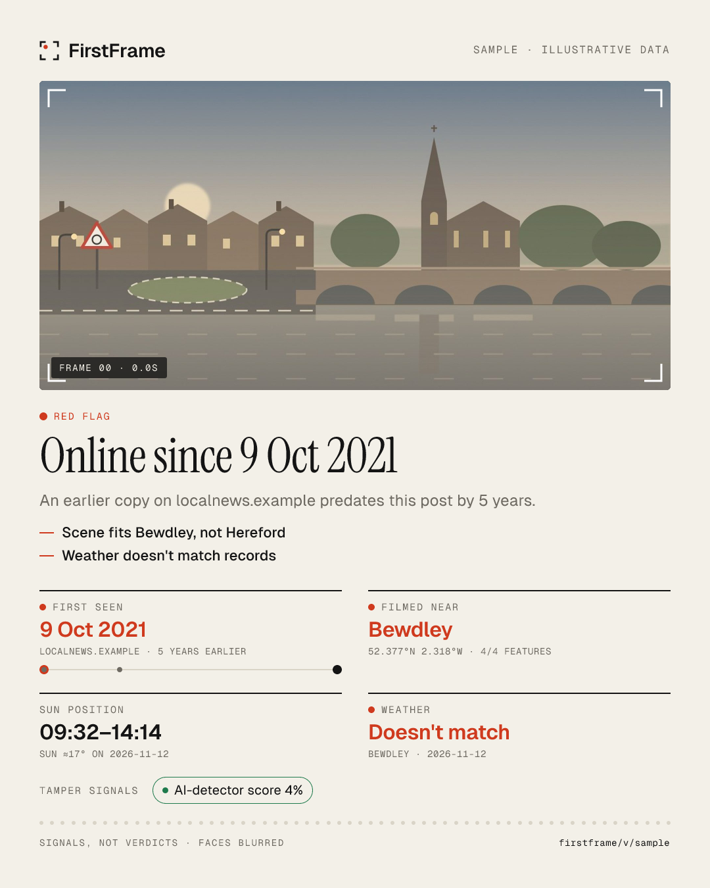
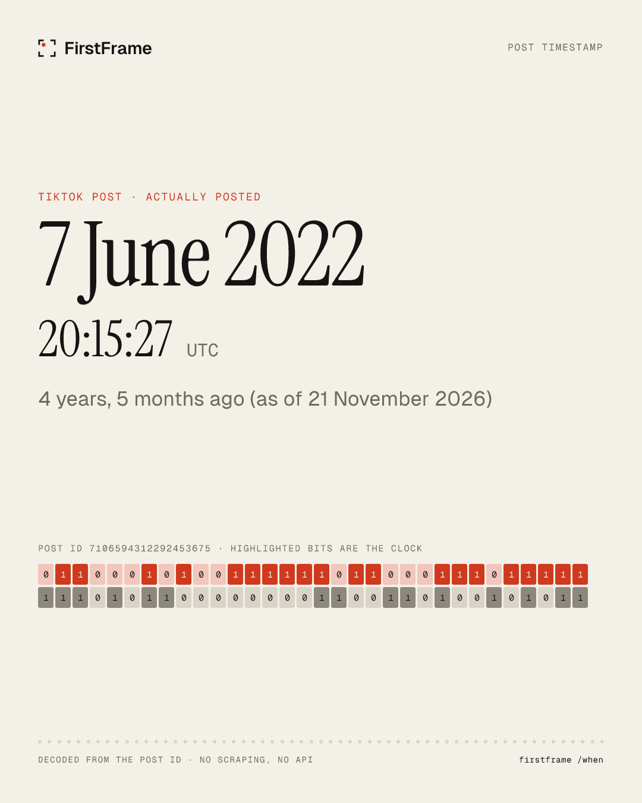
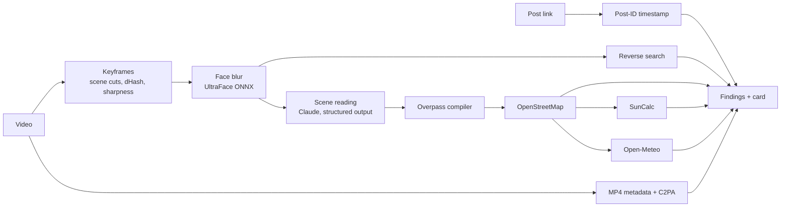

<p align="center">
  
</p>

<h1 align="center">FirstFrame</h1>

<p align="center">
  <strong>Everyone shared it. Nobody checked.</strong><br />
  Check any viral video in your browser: when it was really posted, where it was filmed,<br />
  whether the sun and the weather match, and whether it's been tampered with.
</p>

<p align="center">
  <a href="https://akhsterminator.github.io/firstframe-osint/"><strong>Try it now →</strong></a>
  &nbsp;·&nbsp; free &nbsp;·&nbsp; no sign-up &nbsp;·&nbsp; nothing uploaded
</p>

<p align="center">
  <a href="https://akhsterminator.github.io/firstframe-osint/"></a>
  <a href="https://github.com/akhsterminator/firstframe-osint/actions/workflows/ci.yml"></a>
  <a href="LICENSE"></a>
  
</p>

<p align="center">
  <a href="https://akhsterminator.github.io/firstframe-osint/when/"></a>
</p>

## Every post link hides the second it was posted

TikTok, X, Instagram, Threads, Bluesky and Mastodon all build post IDs from a clock. The time is sitting in the link, and editing the caption can't change it.

Paste a link into **[When](https://akhsterminator.github.io/firstframe-osint/when/)** and you get the exact second. Paste every repost you can find and they line up oldest first, which is how you trace a "breaking" clip back to the upload from 2019. There's a one-click card for posting the reveal, and a **bookmarklet**: drag it to your bookmarks bar, click it on any post, see when it went up.

No API, no scraping, no server. It's arithmetic on the ID, done on the page.

## Three tools, all in your browser

| | | |
|---|---|---|
| **[When](https://akhsterminator.github.io/firstframe-osint/when/)** | When was this really posted? | Decodes post IDs to the second. Bulk mode ranks reposts, and the bookmarklet works on any post. **Instant, no key.** |
| **[Where](https://akhsterminator.github.io/firstframe-osint/where/)** | Where was it filmed? | Pick what's visible (*a church, within 200 m of a roundabout, by a river*) and get every place on Earth where the whole scene fits, with Street View links. Hunts are shareable as links. **No key.** |
| **[Verify](https://akhsterminator.github.io/firstframe-osint/verify/)** | Is it what they say it is? | Drop a video. Keyframes, faces blurred, file metadata, Content Credentials and reverse-search shortcuts. Add your own Claude key and it also reads the scene, searches the map, checks the sun against the claimed date and the weather against the records. Then it makes the card. |

Then post the result. Every check lands on one card, in feed, story and link sizes, with faces blurred:

<p align="center">
  
  &nbsp;
  
  <br /><sub>Left: <a href="https://akhsterminator.github.io/firstframe-osint/sample/">sample report</a> (illustrative data; every domain uses the reserved <code>.example</code> TLD). Right: a real decode.</sub>
</p>

## How the map search works

This is the step verification desks usually do by hand: decide which features in a frame are distinctive, write an [Overpass](https://wiki.openstreetmap.org/wiki/Overpass_API) query, iterate. Bellingcat's [OSM Search](https://github.com/bellingcat/osm-search) made that easier. FirstFrame writes the query for you, from your picks or from Claude's reading of the frames:

```
area["ISO3166-1"="PT"][admin_level=2]->.region;
( nwr["man_made"="lighthouse"](area.region); )->.f_a;                                  // rarest feature anchors the search
( nwr["amenity"="place_of_worship"]["religion"="christian"](around.f_a:300); )->.f_b;
nwr.f_a(around.f_b:300)->.f_a;                                                         // keep anchors where the whole scene fits
.f_a out tags center qt 200;
```

If nothing fits everything, a relaxed pass ranks places that match most of it. Every query is shown with a **Run in Overpass Turbo** link, so you can check it and change it. Feature tags from a model or a shared link are validated and escaped before they go near a query.

## The full check

With a Claude key (yours, kept in your browser, sent only to `api.anthropic.com`), **Verify** runs the whole chain:

1. **Earliest copy.** Post IDs date every copy to the second; reverse-search shortcuts find the copies.
2. **Where.** Claude lists the clues it can see (script on signs, road markings, architecture) and turns them into map features. FirstFrame searches the claimed place first, then each region Claude suggests.
3. **When.** Shadow length gives the sun's height. [SunCalc](https://github.com/mourner/suncalc) turns that into the times of day, and the months, when the shot was possible there.
4. **Weather.** Hourly records from [Open-Meteo](https://open-meteo.com) against the sky in the frame. Sunny footage from a day of 15 mm of rain is a quick tell.
5. **Tampering.** C2PA Content Credentials, file metadata and visual anomalies, each shown as a signal with a strength. Never as a verdict.

A check costs roughly $0.05–$0.30 in API use, depending on the model you pick.

## Verifies events, not individuals

Most OSINT tools that go viral are built for tracking people. FirstFrame is built for checking footage, and designed so it can't easily be turned into anything else.

- **No face recognition.** A 1 MB face *detector* finds faces so they can be blurred before any frame is shown, shared or sent to a model. It returns boxes only. If it can't load, the check stops rather than continue with unblurred frames.
- **No people search.** Reports link to posts, not profiles.
- **Nothing uploaded.** On the public site, videos are processed in your browser tab. There's no server to send them to.
- **No licence plates.** The vision prompt tells the model not to read them. GPS from file metadata is rounded to about 100 m.
- **Signals, not verdicts.** Every finding shows its evidence and how much weight it can bear. AI detectors are labelled as unreliable on compressed social video, because they are.

## Run your own

The public site is the static build. Self-hosting adds what a browser can't do: paste a TikTok or X link and the server downloads it with yt-dlp, runs reverse search automatically (TinEye, and Google Lens, Bing and Yandex via SerpApi), stores reports, and exposes an API and a CLI.

```bash
git clone https://github.com/akhsterminator/firstframe-osint.git
```

```bash
cd firstframe-osint && pnpm install && cp .env.example .env.local
```

```bash
pnpm doctor
```

```bash
pnpm dev
```

`pnpm doctor` lists what's configured and what's missing. Needs Node 22, ffmpeg and yt-dlp. Or use Docker:

```bash
docker compose up --build
```

<details>
<summary><strong>Configuration, CLI and API</strong></summary>

| Variable | Unlocks |
|---|---|
| `ANTHROPIC_API_KEY` | Server-side scene reading, map search, sun and weather checks |
| `TINEYE_API_KEY` | Reverse search with crawl dates. Works from localhost |
| `SERPAPI_KEY` | Google Lens, Bing and Yandex. These fetch frames by URL, so set `PUBLIC_BASE_URL` or use Supabase storage |
| `HIVE_API_KEY`, `SIGHTENGINE_USER` + `SIGHTENGINE_SECRET` | AI-detector signals |
| `SUPABASE_URL` + `SUPABASE_SERVICE_ROLE_KEY` | Postgres and Storage instead of local disk. Run `supabase/migrations` first |

Everything else is in [`.env.example`](.env.example).

**CLI**

```bash
pnpm ff "https://www.tiktok.com/@user/video/7571234567890123456" --place "Hereford" --date 2026-11-12 --card card.png
```

**API**

| | |
|---|---|
| `POST /api/verify` | `{ "url": "...", "claimPlace"?: "...", "claimDate"?: "YYYY-MM-DD" }` or multipart with `file`. Returns `{ id }` |
| `GET /api/reports/:id` | The report as JSON |
| `GET /api/reports/:id/events` | Server-sent events, one per stage update |
| `GET /api/reports/:id/card?format=portrait\|story\|og` | The card as PNG |

**Static build**

```bash
pnpm build:static
```

Writes the browser-only site to `out/`. The included workflow publishes it to GitHub Pages on every push to `main`.

</details>

## How it fits together



The analysis code (post IDs, the Overpass compiler, ranking, sun, weather, findings and the card) is shared between Node and the browser; only frame extraction and face detection have two implementations (ffmpeg + onnxruntime-node on the server, a video element + ONNX Runtime Web in the browser). Every stage takes its external services as arguments, so the test suite runs the whole pipeline end to end on generated video with no network.

```bash
pnpm test
```

## Limits

FirstFrame narrows things down. It doesn't prove them.

- A post ID proves when that **post** was made, not when the video was **filmed**.
- Reverse search only finds what search engines have indexed. "No earlier copy" is not proof of originality.
- The map search depends on OpenStreetMap. Rural areas and some countries are thinly mapped, so a missing candidate isn't evidence against a place.
- The shadow method assumes a vertical object on flat ground. Weather data is gridded at about 10 km, so a local shower can be missed.
- AI detectors misfire on recompressed video, and platforms strip Content Credentials on upload.

Confirm findings with street-level imagery, the original uploader or local sources before you publish.

## Roadmap

- [ ] Browser extension: right-click a video, get the card
- [ ] Street-level confirmation: compare Mapillary imagery for the top candidates
- [ ] Shadow direction plus street bearing from OSM, for azimuth as well as altitude
- [ ] Licence-plate blurring alongside faces
- [ ] A public corpus of solved cases, used as a regression suite

## Contributing

The most useful thing you can send is a video FirstFrame got wrong. [Open a "wrong result" issue](https://github.com/akhsterminator/firstframe-osint/issues/new?template=wrong-result.yml) with what's actually true, and it becomes a test. See [CONTRIBUTING.md](CONTRIBUTING.md) for setup and ground rules.

If FirstFrame helped you catch something, a star helps other people find it.

## Acknowledgements

Built on [OpenStreetMap](https://www.openstreetmap.org/copyright) and its contributors, [Overpass API](https://overpass-api.de), [Nominatim](https://nominatim.org), [Open-Meteo](https://open-meteo.com), [SunCalc](https://github.com/mourner/suncalc), [yt-dlp](https://github.com/yt-dlp/yt-dlp), [FFmpeg](https://ffmpeg.org), [MapLibre](https://maplibre.org), [OpenFreeMap](https://openfreemap.org), [ONNX Runtime](https://onnxruntime.ai), [Satori](https://github.com/vercel/satori) and [Ultra-Light-Fast-Generic-Face-Detector](https://github.com/Linzaer/Ultra-Light-Fast-Generic-Face-Detector-1MB). The workflow follows methods published by the open-source investigations community, Bellingcat and BBC Verify in particular.

## Licence

MIT. Fonts are under the SIL Open Font License; see [`assets/fonts/OFL.txt`](assets/fonts/OFL.txt).
