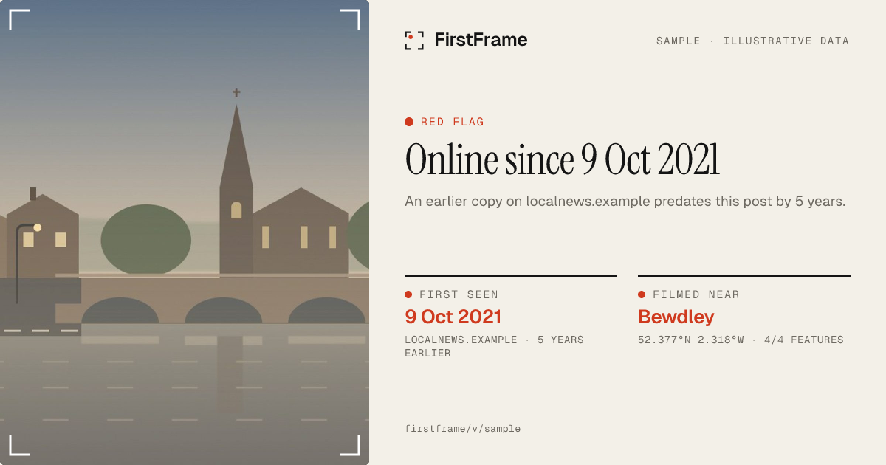
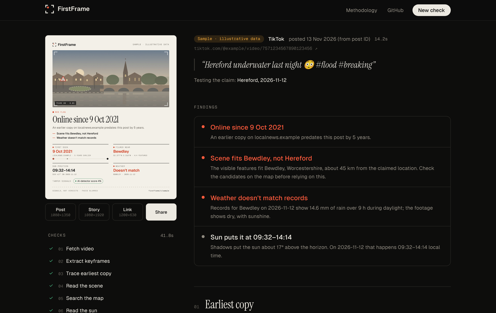
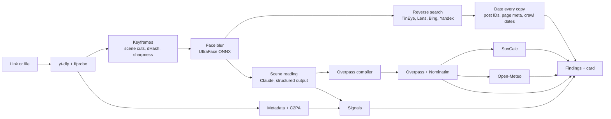

<p align="center">
  
</p>

<h1 align="center">FirstFrame</h1>

<p align="center">
  <strong>Verify any viral video in 60 seconds.</strong><br />
  Where it first appeared, where it was filmed, roughly when, and whether it shows signs of editing,<br />
  on one card you can share.
</p>

<p align="center">
  <a href="https://github.com/akhsterminator/firstframe-osint/actions/workflows/ci.yml"></a>
  <a href="LICENSE"></a>
  
</p>

<p align="center">
  
  <br /><sub>Sample card. The data is illustrative and every domain uses the reserved <code>.example</code> TLD.</sub>
</p>

---

Every week a clip goes viral as breaking news when it's actually from 2019, or from a different country. Newsroom verification desks catch these by hand, moving a few frames through five to ten separate tools: reverse image search, a map, a sun calculator, a weather archive, a metadata viewer.

FirstFrame chains those steps into one pass. Paste a TikTok, X or Instagram link (or upload a file) and it:

| | Check | How |
|---|---|---|
| 01 | **Finds the earliest copy** | Keyframes through TinEye, Google Lens, Bing and Yandex. Every match is dated from **post IDs** (TikTok, X, Instagram, Threads, Bluesky and Mastodon IDs encode their creation time), page metadata and crawl records, then lined up oldest first. |
| 02 | **Searches the map** | A vision model lists what's visible as OpenStreetMap features: *a church within 350 m of a multi-arch bridge over a river, near a roundabout*. FirstFrame compiles that into an Overpass query and plots every place where the whole scene fits. |
| 03 | **Reads the sun** | Shadow length gives the sun's altitude. SunCalc turns it into the times of day, and the months of the year, when the shot was possible at that spot. |
| 04 | **Checks the weather** | Historical hourly records from Open-Meteo, compared with the sky in the frame. Sunny footage from a day with 15 mm of rain is a quick tell. |
| 05 | **Looks for tampering** | C2PA Content Credentials, file metadata, AI-detector scores and visual anomalies, each shown as a signal with a strength and a direction. Never as a verdict. |
| 06 | **Makes the card** | Feed (1080×1350), story (1080×1920) and link-preview (1200×630) sizes, faces blurred, with a link to the full evidence. |

<p align="center">
  
</p>

## The map search

This is the part that's usually done by hand. Investigators read a frame, decide which features are distinctive, write an Overpass query (or use a tool like Bellingcat's [OSM Search](https://github.com/bellingcat/osm-search)), and iterate.

FirstFrame asks the vision model for a small graph instead of a guess:

```json
{
  "features": [
    { "id": "a", "label": "Multi-arch stone bridge", "tagSets": [[{"key":"bridge","value":"yes"},{"key":"highway","value":null}]], "rarity": "uncommon" },
    { "id": "b", "label": "Church with spire",       "tagSets": [[{"key":"amenity","value":"place_of_worship"},{"key":"religion","value":"christian"}]], "rarity": "uncommon" },
    { "id": "c", "label": "River",                   "tagSets": [[{"key":"waterway","value":"river"}]], "rarity": "uncommon" }
  ],
  "relations": [{ "from": "a", "to": "c", "maxDistanceM": 60 }, { "from": "a", "to": "b", "maxDistanceM": 350 }],
  "regions": [{ "name": "England", "countryCode": "GB", "subdivisionCode": "GB-ENG" }]
}
```

and compiles it, deterministically, into Overpass QL:

```
area["ISO3166-2"="GB-ENG"]->.region;
( nwr["bridge"="yes"]["highway"](area.region); )->.f_a;          // rarest feature anchors the search
( nwr["waterway"="river"](around.f_a:60); )->.f_c;
( nwr["amenity"="place_of_worship"]["religion"="christian"](around.f_a:350); )->.f_b;
nwr.f_a(around.f_b:350)->.f_a;                                     // walk back up: keep only anchors
nwr.f_a(around.f_c:60)->.f_a;                                      // where the whole scene fits
.f_a out tags center qt 200;
```

If nothing fits everything, a relaxed pass ranks places that match most of it. The claimed location is searched first, then each region hypothesis. Every query is shown in the report with a one-click **Run in Overpass Turbo** link, so you can check it and edit it. The model's tags are validated and escaped before they go anywhere near a query string.

## Verifies events, not individuals

Most OSINT tools that go viral are built for tracking people. FirstFrame is built for checking footage, and it's designed so it can't easily be turned into anything else.

- **No face recognition.** A 1 MB face *detector* finds face regions and blurs them before any frame is stored, shown, sent to the vision model or sent to a search engine. It returns boxes only. If the model is missing, the job stops rather than store an unblurred frame.
- **No people search.** Reports link to posts, not profiles. No usernames or account data are collected.
- **No licence plates.** The vision prompt tells the model not to read them.
- **Rounded GPS.** Coordinates from file metadata are rounded to about 100 m.
- **Signals, not verdicts.** Every finding shows its evidence and its confidence. AI detectors are labelled as unreliable on compressed social video, because they are.

## Quick start

You need Node 22, pnpm, ffmpeg, and [yt-dlp](https://github.com/yt-dlp/yt-dlp) for links.

```bash
git clone https://github.com/akhsterminator/firstframe-osint.git
```

```bash
cd firstframe-osint && pnpm install
```

```bash
cp .env.example .env.local
```

```bash
pnpm doctor
```

```bash
pnpm dev
```

Open http://localhost:3000, or go straight to http://localhost:3000/v/sample to see a full report without any keys.

`pnpm doctor` tells you what's configured and what's missing. With no keys at all, FirstFrame still downloads, extracts and blurs keyframes, decodes post timestamps, reads metadata and Content Credentials, and makes a card. Each key switches on more:

| Variable | Unlocks |
|---|---|
| `ANTHROPIC_API_KEY` | Scene reading, and with it the map search, sun and weather checks |
| `TINEYE_API_KEY` | Reverse search with crawl dates. Works from localhost |
| `SERPAPI_KEY` | Google Lens, Bing and Yandex. These fetch frames by URL, so set `PUBLIC_BASE_URL` or use Supabase storage |
| `HIVE_API_KEY`, `SIGHTENGINE_USER` + `SIGHTENGINE_SECRET` | AI-detector signals |
| `SUPABASE_URL` + `SUPABASE_SERVICE_ROLE_KEY` | Postgres + Storage instead of local disk. Run `supabase/migrations` first |

Everything else is in [`.env.example`](.env.example). OpenStreetMap, Overpass, Nominatim, Open-Meteo and SunCalc need no keys.

## Command line

```bash
pnpm ff "https://www.tiktok.com/@user/video/7571234567890123456" --place "Hereford" --date 2026-11-12 --card card.png
```

```
  ✓ Fetch video
  ✓ Extract keyframes
  ✓ Trace earliest copy
  ✓ Read the scene
  ✓ Search the map
  ✓ Read the sun
  ✓ Check the weather
  ✓ Look for tampering

  ■ Online since 9 Oct 2021
    An earlier copy on localnews.example predates this post by 5 years.
```

Add `--json` for the full report, or pass a file path instead of a URL.

## API

| | |
|---|---|
| `POST /api/verify` | `{ "url": "...", "claimPlace"?: "...", "claimDate"?: "YYYY-MM-DD" }` or multipart with `file`. Returns `{ id }` |
| `GET /api/reports/:id` | The report as JSON |
| `GET /api/reports/:id/events` | Server-sent events, one per stage update |
| `GET /api/reports/:id/card?format=portrait\|story\|og` | The card as PNG. Add `&download=1` for an attachment |
| `GET /api/health` | Which checks this instance can run |

## Deploy

FirstFrame needs ffmpeg and yt-dlp on the server, so it runs as a Node server rather than on serverless functions.

```bash
docker compose up --build
```

The image includes ffmpeg and yt-dlp, runs as a non-root user and stores data in a volume. For a public instance, set `PUBLIC_BASE_URL`, keep `FF_RATE_LIMIT` on (every check spends API credit), and point `FF_TILE_URL` at your own tile server: the public OpenStreetMap tiles aren't meant for heavy use.

## How it fits together



Each stage records its own status, so one failure never sinks the rest. Stages that don't depend on each other run in parallel. Reports update live over server-sent events. Every stage takes its external services as arguments, which is why the test suite runs the whole pipeline end to end on a generated video with no network access.

```bash
pnpm test
```

## Limits

FirstFrame narrows things down. It doesn't prove them.

- Reverse search only finds what search engines have indexed. New uploads take time to show up, and "no earlier copy" is not proof of originality.
- The map search depends on OpenStreetMap being complete. Rural areas and some countries are thinly mapped; a missing candidate isn't evidence against a place.
- The shadow method assumes a vertical object on flat ground and a measurable shadow.
- Weather data is gridded at roughly 10 km. A local shower can be missed, so weak mismatches are reported as inconclusive.
- AI detectors misfire on recompressed video, and platforms strip Content Credentials on upload.

Confirm findings with street-level imagery, the original uploader or local sources before you publish.

## Roadmap

- [ ] Street-level confirmation: pull Mapillary imagery for the top candidates and compare
- [ ] Shadow direction plus street bearing from OSM, for azimuth as well as altitude
- [ ] Licence-plate blurring alongside faces
- [ ] Audio fingerprinting for clips that were re-cut with new visuals
- [ ] Browser extension: right-click a video, get a card
- [ ] A public corpus of solved cases, used as a regression suite

## Contributing

The most useful thing you can send is a video FirstFrame got wrong. [Open a "wrong result" issue](https://github.com/akhsterminator/firstframe-osint/issues/new?template=wrong-result.yml) with what's actually true, and it becomes a test. See [CONTRIBUTING.md](CONTRIBUTING.md) for setup and the project's ground rules.

## Acknowledgements

Built on [OpenStreetMap](https://www.openstreetmap.org/copyright) and its contributors, [Overpass API](https://overpass-api.de), [Nominatim](https://nominatim.org), [Open-Meteo](https://open-meteo.com), [SunCalc](https://github.com/mourner/suncalc), [yt-dlp](https://github.com/yt-dlp/yt-dlp), [FFmpeg](https://ffmpeg.org), [MapLibre](https://maplibre.org), [Satori](https://github.com/vercel/satori) and [Ultra-Light-Fast-Generic-Face-Detector](https://github.com/Linzaer/Ultra-Light-Fast-Generic-Face-Detector-1MB). The workflow follows methods published by the open-source investigations community, Bellingcat and BBC Verify in particular.

## Licence

MIT. Fonts are under the SIL Open Font License; see [`assets/fonts/OFL.txt`](assets/fonts/OFL.txt).
